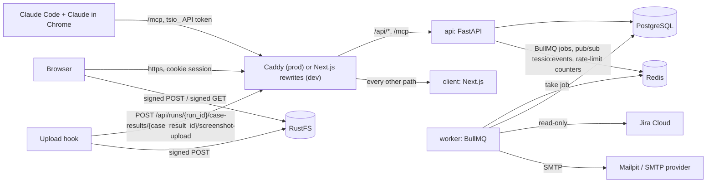

# Architecture overview

**Status:** Accepted
Updated: 2026-11-01

How the parts of Tessio fit together, as built. The design record with the full schema, endpoints and MCP tools is the [server proposal](../discussions/server-proposal.md); what each feature does today is in the [functional specs](../spec/README.md).

## Repository

```
tessio/
├── client/                    Next.js 16 app (TypeScript, Mantine 9, SCSS modules)
├── server/                    FastAPI app: REST API + MCP server + BullMQ worker
├── claude/                    Claude Code plugin
│   ├── skills/                run-story-tests, review-readiness, rerun-failed
│   ├── hooks/                 upload_screenshots.py (PostToolUse hook) and its tests
│   ├── .mcp.json              the Tessio MCP server, authenticated with a tsio_ API token
│   └── scripts/               measure-tokens.sh
├── .claude-plugin/            marketplace.json: the marketplace whose plugin source is ./claude
├── e2e/                       Playwright end-to-end suite
├── deploy/                    Caddyfile, deploy.sh and the deploy run book
├── docker-compose.yml         local services: Postgres, Redis, Bull Board, Mailpit, RustFS
├── compose.prod.yml           the VPS stack
├── .github/workflows/         ci.yml, e2e.yml
└── docs/                      this folder
```

## System



- In development the browser talks to Next.js on port 3201, and [client/next.config.ts](../../client/next.config.ts) rewrites `/api/:path*` and `/mcp` to `TESSIO_SERVER_URL` (default `http://localhost:3202`). In production Caddy does the same routing ([deploy/Caddyfile](../../deploy/Caddyfile), [ADR 0009](../decisions/0009-production-storage-and-proxy.md)). Either way the client and API share one origin, so the session cookie stays same-site and no CORS is needed.
- Files never pass through the API. The API signs an upload or download after its permission check, and the browser or the upload hook talks to RustFS directly.
- The server never runs a browser. Claude drives the application under test in Chrome on the developer's machine, and testers run manual cases by hand.

## Server request path

1. `modules/<module>/router.py` unpacks the request (a `WireModel`) and calls **one use case** from the container through `dependencies.py`.
2. The use case resolves the caller's access with `ProjectAccessResolver.resolve` and checks it with `require(access, Capability.X)` from [app/shared/permissions](../../server/app/shared/permissions/). A non-member gets 404, a missing capability 403, and a write on an archived project 409 `PROJECT_ARCHIVED`.
3. It reads and writes through repository ports (`domains/<name>/repository.py`, ABCs), implemented by `Postgres<Name>Repository` classes in `infrastructure/`, inside one transaction.
4. Errors are `TessioError` subclasses; [app/api/error_handlers.py](../../server/app/api/error_handlers.py) turns them into `{"code", "message"}` with the matching HTTP status.

MCP tools (`modules/{runs,gaps,story_context}/mcp_tools.py`, registered in `Container.mcp_server`) call the **same use cases** with an API-token `Actor`, so REST and MCP share every rule. [app/container.py](../../server/app/container.py) is the only place that builds adapters; `import-linter` keeps the module layers in order ([server proposal §3](../discussions/server-proposal.md#3-code-layout)).

## Cross-cutting pieces

| Piece | Names in the code | What it does |
| --- | --- | --- |
| Background jobs | `JobQueue` port, `BullmqJobQueue`; worker `python -m app.workers.worker` with `build_job_workers` and `Container.job_schedules` | The API adds jobs to Redis; the worker runs email, Jira sync and three maintenance schedules ([ADR 0006](../decisions/0006-background-jobs-redis-bullmq.md)) |
| Live events | `LiveEventPublisher`, `RedisLiveEventHub`, the `live_events` module | Use cases publish a `LiveEvent` after commit on the Redis channel `tessio:events`; `GET /api/events` streams it as server-sent events to users who can see the project |
| File storage | `ObjectStorage` port, `S3ObjectStorage` | Signed POST uploads and 5-minute signed GET downloads against RustFS ([ADR 0005](../decisions/0005-local-object-storage.md)) |
| Email | `QueuedMailer` → `email.send` job → `SmtpMailer` | Mail is queued, then sent by the worker over SMTP |
| Secrets | `SecretCipher` (AES-256-GCM with a key ring), `SecretMasker` | Encrypts TOTP keys, secrets and the Jira token; masks resolved secret values in summaries, results and errors |
| Rate limits | `RedisRateLimiter` in `app/shared/rate_limit/` | Fixed-window counters in Redis, keyed by client IP, on the public auth routes (sign-in, two-factor, invite and password links); fails open when Redis is down |

## Client data layer

- `apiClient` in [client/src/lib/api/api-client.ts](../../client/src/lib/api/api-client.ts) is an `openapi-fetch` client typed by `openapi.type.ts`, which `npm run generate:api` generates from `openapi.json` (written by the server's `export_openapi` command).
- `useAppQuery` and `useAppMutation` in `client/src/shared/hooks/` wrap TanStack Query. Each request has one hook in `modules/<feature>/hooks/{queries,mutations}`.
- `useLiveEvents` opens the `GET /api/events` stream and, for each event type, invalidates the query keys listed in `LIVE_EVENT_QUERY_KEYS` ([live-event-query-keys.constant.ts](../../client/src/shared/typing/constants/live-event-query-keys.constant.ts)).
- [client/src/proxy.ts](../../client/src/proxy.ts) (Next.js 16's renamed middleware) redirects by the session cookie: a visitor without one is sent to sign-in with the page to return to. `SessionGuard` (`components/session-guard`) then checks the session itself with `GET /api/auth/me`.
- UI comes from the `DS*` components in `components/design-system` (Mantine 9 wrapped); text is translated in English, French and Vietnamese ([ADR 0002](../decisions/0002-ui-library.md), [ADR 0003](../decisions/0003-translations.md)).

## Further reading

- [Server proposal](../discussions/server-proposal.md): schema, endpoints, MCP tools, screenshots, jobs, deployment.
- [Functional specs](../spec/README.md) and the [user flows and state diagrams](../design/user-flows.md).
- Decisions: [0001](../decisions/0001-frontend-stack.md) frontend stack, [0002](../decisions/0002-ui-library.md) UI library, [0003](../decisions/0003-translations.md) translations, [0004](../decisions/0004-backend-stack.md) backend stack, [0005](../decisions/0005-local-object-storage.md) local object storage, [0006](../decisions/0006-background-jobs-redis-bullmq.md) background jobs, [0007](../decisions/0007-hosting-vps-docker.md) hosting, [0008](../decisions/0008-branching-strategy.md) branching, [0009](../decisions/0009-production-storage-and-proxy.md) production storage and reverse proxy.
- [deploy/README.md](../../deploy/README.md): running Tessio on the VPS.
- [Claude setup guide](../guides/claude-setup.md): connecting Claude Code to Tessio.
