# User flows and state diagrams

**Status:** Draft · **Updated:** 2026-11-01

WBS 2.5. The flows people follow through Tessio as the code works today, and the state machines behind them. Each flow has a diagram and a step table that links to the story in the [functional specs](../spec/README.md). Routes are client routes; `/api/…` paths and MCP tools are server calls.

## 1. Onboarding: invite, password, two-factor

A workspace admin invites a person; the person sets a password and sets up two-factor before seeing any project. The branches show a later sign-in and a forgotten password.

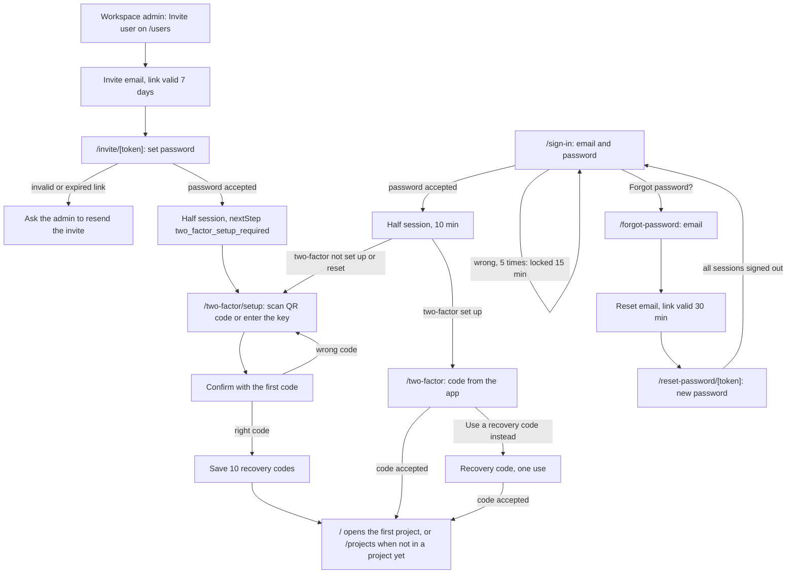

| Step | Who | Screen route or MCP tool | Result | Spec story id |
| --- | --- | --- | --- | --- |
| 1 | Workspace admin | `/users` → Invite user (`POST /api/users`) | User `invited`, invite email sent | [USER-2](../spec/user-management.md#user-2-invite-a-user-wbs-33b1) |
| 2 | Invited person | `/invite/[token]` (`POST /api/auth/invites/{token}`) | User `active`, half session, `two_factor_setup_required` | [AUTH-3](../spec/authentication-and-account.md#auth-3-accept-an-invite-wbs-322) |
| 3 | Invited person | `/two-factor/setup` (`POST /api/auth/two-factor/setup`) | QR code and manual key | [AUTH-4](../spec/authentication-and-account.md#auth-4-set-up-two-factor-wbs-323) |
| 4 | Invited person | Confirm (`POST /api/auth/two-factor/confirm`) | Full session, 10 recovery codes shown once | [AUTH-4](../spec/authentication-and-account.md#auth-4-set-up-two-factor-wbs-323) |
| 5 | Invited person | Continue → `/` | First project's dashboard, or `/projects` | [SHELL-3](../spec/app-shell.md#shell-3-home-route-wbs-312) |
| 6 | User | `/sign-in` (`POST /api/auth/sign-in`) | Half session; `two_factor_required` or `two_factor_setup_required` | [AUTH-1](../spec/authentication-and-account.md#auth-1-sign-in-with-email-and-password-wbs-321) |
| 7 | User | `/two-factor` (`POST /api/auth/two-factor`) | Full session with a TOTP or recovery code | [AUTH-2](../spec/authentication-and-account.md#auth-2-two-factor-step-at-sign-in-wbs-321-323) |
| 8 | User | `/forgot-password` → email → `/reset-password/[token]` | New password; every session signed out | [AUTH-5](../spec/authentication-and-account.md#auth-5-forgot-and-reset-password-wbs-324) |

## 2. The sprint testing loop

From the Jira sync to QC sign-off. Every open gap blocks the run; a failure stays active until QC verifies it, and the story cannot be signed off as Passed while a failure is active.

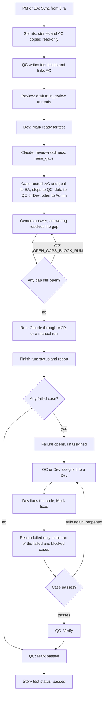

| Step | Who | Screen route or MCP tool | Result | Spec story id |
| --- | --- | --- | --- | --- |
| 1 | PM or BA | `/projects/[projectKey]/stories` → Sync from Jira | `jira.sync_project` job; sprints, stories and AC updated | [STORY-4](../spec/sprints-and-stories.md#story-4-sync-from-jira-wbs-354), [STORY-5](../spec/sprints-and-stories.md#story-5-ac-parsed-from-the-description-wbs-353-374) |
| 2 | QC | `/projects/[projectKey]/test-cases/new` | Case `TC-<n>` in `draft`, linked to AC | [CASE-2](../spec/test-cases.md#case-2-write-a-test-case-wbs-362), [CASE-3](../spec/test-cases.md#case-3-link-cases-to-ac-wbs-363) |
| 3 | QC | Traceability tab of `/projects/[projectKey]/stories/[jiraKey]` | Uncovered AC warning until every AC has a case | [TRACE-2](../spec/traceability.md#trace-2-uncovered-ac-warning-wbs-372) |
| 4 | QC | `/projects/[projectKey]/test-cases/[caseCode]` → Submit for review → Mark ready | Case `ready` | [CASE-6](../spec/test-cases.md#case-6-review-workflow-wbs-365) |
| 5 | Dev | `/projects/[projectKey]/stories/[jiraKey]` → Mark ready for test | Story `ready_for_test` | [STORY-7](../spec/sprints-and-stories.md#story-7-dev-marks-a-story-ready-for-test-wbs-356) |
| 6 | Claude (started by a Dev) | MCP `get_story_context`, `get_open_gaps`, `raise_gaps` | Gaps `open`, routed, `gap_assigned` sent | [GAP-2](../spec/readiness-review.md#gap-2-raise-gaps-wbs-381-382), [GAP-3](../spec/readiness-review.md#gap-3-automatic-routing-wbs-382) |
| 7 | BA, QC, Dev, Admin | `/gaps` or the story's Gaps tab → Answer | Gap `resolved`; QC updates cases, BA updates AC in Jira and syncs | [GAP-4](../spec/readiness-review.md#gap-4-answer-and-resolve-wbs-383), [GAP-7](../spec/readiness-review.md#gap-7-gap-inbox-wbs-385) |
| 8 | Claude or QC | MCP `start_run`, or `/projects/[projectKey]/runs/new` | Run `running`, story `in_test` | [RUN-2](../spec/runs.md#run-2-start-a-claude-run-wbs-3103), [RUN-8](../spec/runs.md#run-8-manual-run-wbs-3104) |
| 9 | Claude or QC | MCP `finish_run`, or Finish run | Run `passed`, `failed` or `aborted`; report; `run_finished` | [RUN-6](../spec/runs.md#run-6-finish-a-run-and-build-the-report-wbs-3106) |
| 10 | Server | (on each `failed` result) | Failure `open`, unassigned | [FAIL-1](../spec/failures.md#fail-1-a-failed-result-opens-a-failure-wbs-3113) |
| 11 | QC or Dev | `/projects/[projectKey]/failures/[failureId]` → Assign | Assignee set, `failure_assigned` sent | [FAIL-5](../spec/failures.md#fail-5-assign-a-failure-wbs-3115) |
| 12 | Dev | Same page → Mark fixed | Failure `fixed` | [FAIL-4](../spec/failures.md#fail-4-mark-fixed-verify-reopen-wbs-3113) |
| 13 | Dev with Claude, or QC | MCP `get_failed_cases` + `start_run(parent_run_id)`, or Re-run failed | Child run of the failed and blocked cases still `ready` | [RUN-9](../spec/runs.md#run-9-re-run-failed-only-wbs-3105) |
| 14 | Server | (a `failed` result on a `fixed` failure) | Failure `reopened` automatically | [FAIL-1](../spec/failures.md#fail-1-a-failed-result-opens-a-failure-wbs-3113) |
| 15 | QC | Failure page → Verify | Failure `verified` | [FAIL-4](../spec/failures.md#fail-4-mark-fixed-verify-reopen-wbs-3113) |
| 16 | QC | Story page → Mark passed | Story `passed`; refused while a failure is active or a run is running | [STORY-6](../spec/sprints-and-stories.md#story-6-qc-sign-off-wbs-355) |

## 3. A Claude run

What happens when a Dev asks Claude Code to test a story with the `run-story-tests` skill. Claude drives the browser with Claude in Chrome; Tessio only stores what Claude sends. The screenshots go from the disk to storage through the plugin's hook, so the model never spends tokens on them.

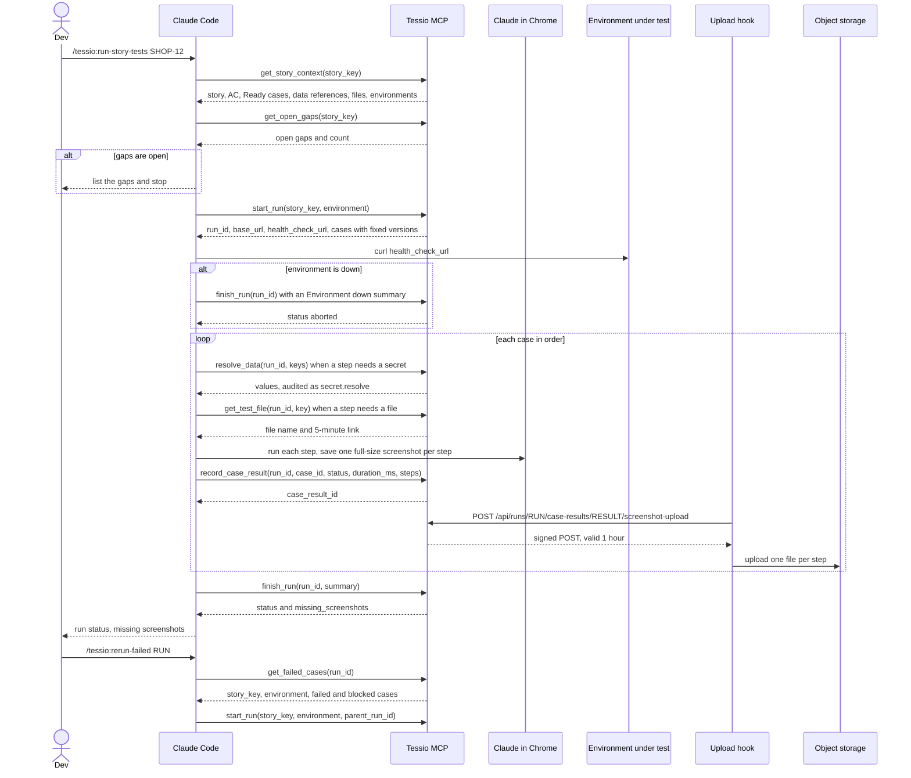

| Step | Who | Screen route or MCP tool | Result | Spec story id |
| --- | --- | --- | --- | --- |
| 1 | Claude | `get_story_context(story_key)` | Story, active AC, Ready cases, data with secrets as `{{data.key}}`, files, environments | [RUN-11](../spec/runs.md#run-11-story-context-and-test-files-for-claude-wbs-3103) |
| 2 | Claude | `get_open_gaps(story_key)` | Stops when any gap is open | [GAP-6](../spec/readiness-review.md#gap-6-open-gaps-block-runs-wbs-384) |
| 3 | Claude | `start_run(story_key, environment?, case_ids?)` | Run `running`, story `in_test`, `run.started` | [RUN-2](../spec/runs.md#run-2-start-a-claude-run-wbs-3103) |
| 4 | Claude | `curl` on the health-check URL | Down: `finish_run` with no results, run `aborted` | [RUN-3](../spec/runs.md#run-3-health-check-before-the-run-wbs-3103) |
| 5 | Claude | `resolve_data(run_id, keys)` | Secret values for this run, each audited | [DATA-5](../spec/environments-and-test-data.md#data-5-secrets-during-a-run-wbs-394) |
| 6 | Claude | `get_test_file(run_id, key, case_id?)` | 5-minute download link; file version recorded | [RUN-11](../spec/runs.md#run-11-story-context-and-test-files-for-claude-wbs-3103) |
| 7 | Claude | `record_case_result(...)` once per case | Case and step results, masked; `run.case_recorded`; a failure if `failed` | [RUN-4](../spec/runs.md#run-4-record-a-case-result-wbs-3102-3103) |
| 8 | Upload hook | `POST /api/runs/{run_id}/case-results/{case_result_id}/screenshot-upload` | One file per step in storage; failed uploads retried later | [RUN-5](../spec/runs.md#run-5-screenshot-upload-by-the-hook-wbs-3102) |
| 9 | Claude | `finish_run(run_id, summary)` | Status from the results, report, missing screenshots, `run_finished` | [RUN-6](../spec/runs.md#run-6-finish-a-run-and-build-the-report-wbs-3106) |
| 10 | Claude | `get_failed_cases(run_id)`, then `start_run(..., parent_run_id)` | Child run of the failed and blocked cases | [RUN-9](../spec/runs.md#run-9-re-run-failed-only-wbs-3105) |

## 4. A manual run

A QC runs the Ready cases by hand and records each step in the browser.

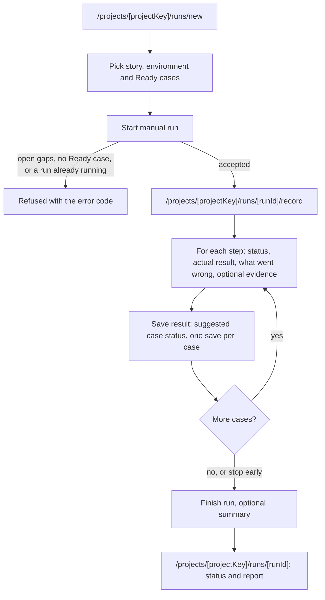

| Step | Who | Screen route or MCP tool | Result | Spec story id |
| --- | --- | --- | --- | --- |
| 1 | QC or Admin | `/projects/[projectKey]/runs/new` (`POST /api/projects/{project_key}/runs`) | Manual run `running`, story `in_test` | [RUN-8](../spec/runs.md#run-8-manual-run-wbs-3104) |
| 2 | Same person | `/projects/[projectKey]/runs/[runId]/record`, evidence via `POST …/uploads` kind `evidence` | Evidence uploaded | [RUN-8](../spec/runs.md#run-8-manual-run-wbs-3104) |
| 3 | Same person | Save result (`PUT …/runs/{run_id}/cases/{test_case_id}`) | Case result, unmarked steps `skipped`, a failure if `failed` | [RUN-8](../spec/runs.md#run-8-manual-run-wbs-3104), [FAIL-1](../spec/failures.md#fail-1-a-failed-result-opens-a-failure-wbs-3113) |
| 4 | Same person | Finish run (`POST …/runs/{run_id}/finish`) | Run status and report; `run_finished` | [RUN-8](../spec/runs.md#run-8-manual-run-wbs-3104), [RUN-6](../spec/runs.md#run-6-finish-a-run-and-build-the-report-wbs-3106) |
| 5 | Anyone | `/projects/[projectKey]/runs/[runId]` | Results and Report tabs | [RUN-7](../spec/runs.md#run-7-run-detail-and-live-progress-wbs-3102-3103) |

## 5. Connect Claude

A developer creates a personal token and installs the Tessio plugin with it, once per project.

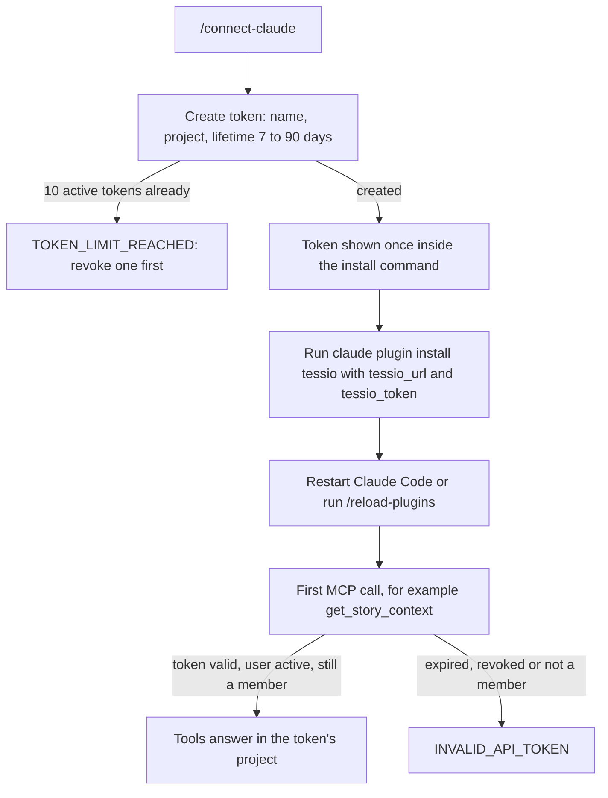

| Step | Who | Screen route or MCP tool | Result | Spec story id |
| --- | --- | --- | --- | --- |
| 1 | Dev (any role) | `/connect-claude` → Create token (`POST /api/me/api-tokens`) | `tsio_…` token for one project, stored as a hash | [AUTH-10](../spec/authentication-and-account.md#auth-10-create-an-api-token-for-claude-wbs-326) |
| 2 | Dev | Terminal: `claude plugin install tessio --marketplace … --config tessio_url=… --config tessio_token=…` | Plugin with the MCP server, hook and skills | [AUTH-10](../spec/authentication-and-account.md#auth-10-create-an-api-token-for-claude-wbs-326) |
| 3 | Dev | Claude Code: any Tessio tool, for example `get_story_context` | Answer in the token's project, with the owner's current role | [RUN-11](../spec/runs.md#run-11-story-context-and-test-files-for-claude-wbs-3103) |
| 4 | Dev | `/connect-claude` → Revoke | Token stops working at once | [AUTH-11](../spec/authentication-and-account.md#auth-11-list-and-revoke-tokens-wbs-326) |

## State diagrams

Each diagram is built from the transition constant named under it.

### Story test status

`TEST_STATUS_TRANSITIONS` in [test_status.py](../../server/app/modules/stories/typing/constants/test_status.py). Spec: [STORY-6](../spec/sprints-and-stories.md#story-6-qc-sign-off-wbs-355), [STORY-7](../spec/sprints-and-stories.md#story-7-dev-marks-a-story-ready-for-test-wbs-356).

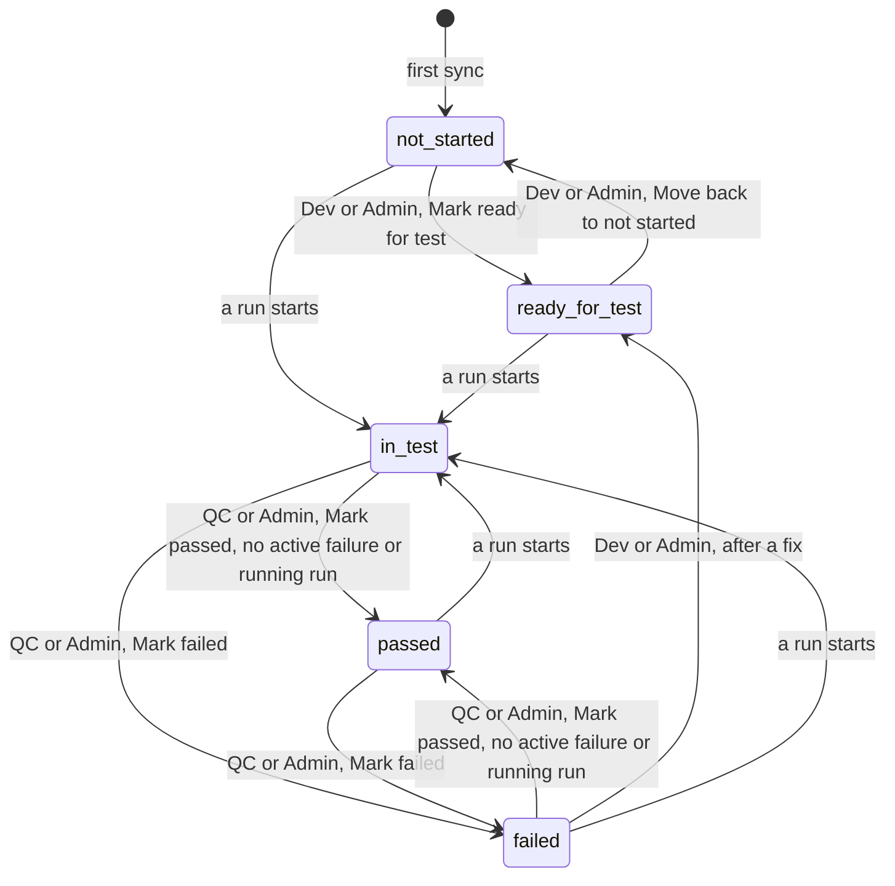

### Test case status

`TEST_CASE_STATUS_TRANSITIONS` in [test_case_status.py](../../server/app/modules/test_cases/typing/constants/test_case_status.py). Spec: [CASE-6](../spec/test-cases.md#case-6-review-workflow-wbs-365).

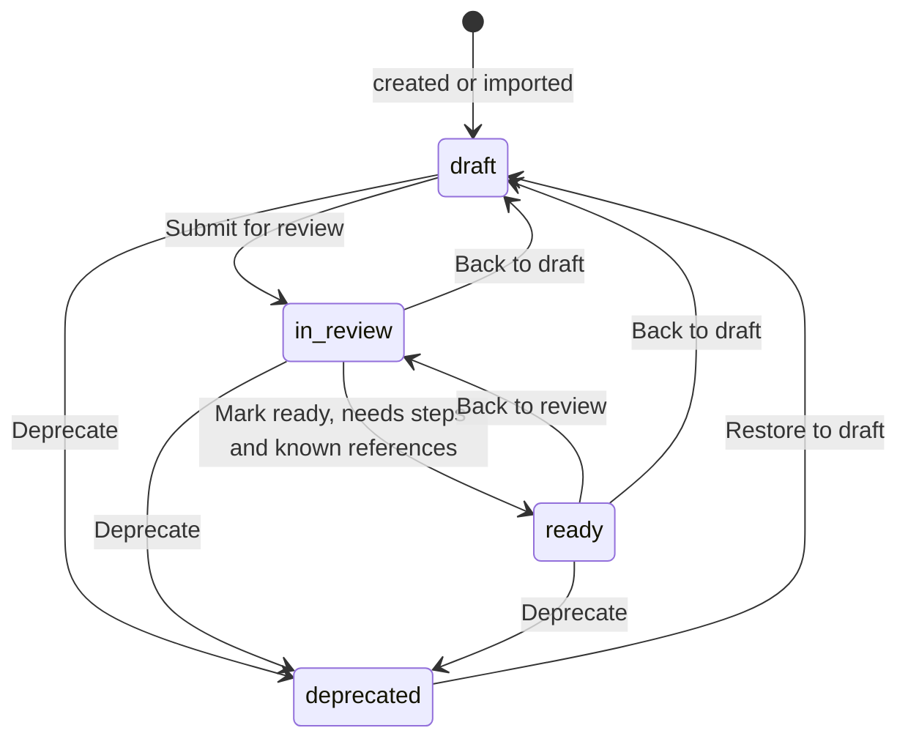

### Run status

`decide_run_status` and `resolve_finished_status` in [run_status.py](../../server/app/modules/runs/utils/run_status.py); the stale abort in [abort_stale_runs.py](../../server/app/modules/runs/usecases/abort_stale_runs.py). Spec: [RUN-6](../spec/runs.md#run-6-finish-a-run-and-build-the-report-wbs-3106), [RUN-10](../spec/runs.md#run-10-aborted-runs-wbs-3108).

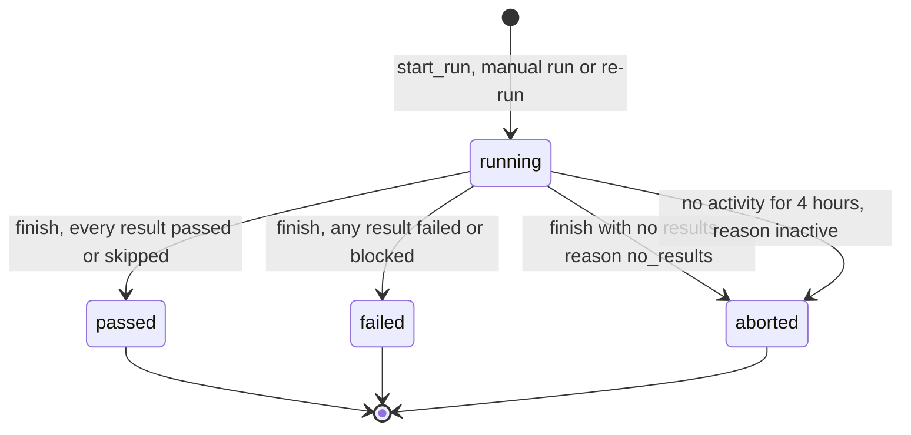

### Failure status

`MANUAL_STATUS_TRANSITIONS` in [failure.py](../../server/app/modules/failures/typing/constants/failure.py) and the automatic moves in [apply_case_result.py](../../server/app/modules/failures/usecases/apply_case_result.py). Spec: [FAIL-1](../spec/failures.md#fail-1-a-failed-result-opens-a-failure-wbs-3113), [FAIL-4](../spec/failures.md#fail-4-mark-fixed-verify-reopen-wbs-3113).

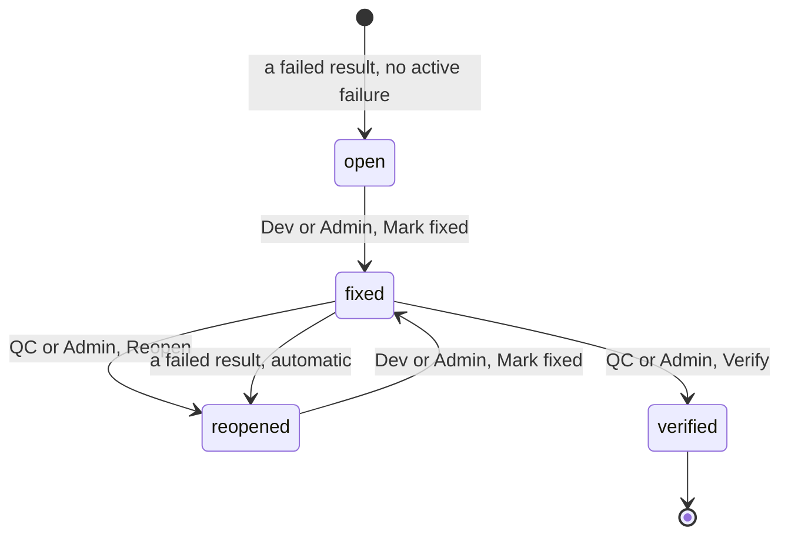

### Gap status

`GapStatus` with the answer and reopen use cases in [server/app/modules/gaps/usecases](../../server/app/modules/gaps/usecases). Spec: [GAP-4](../spec/readiness-review.md#gap-4-answer-and-resolve-wbs-383), [GAP-5](../spec/readiness-review.md#gap-5-reopen-and-reassign-wbs-383).

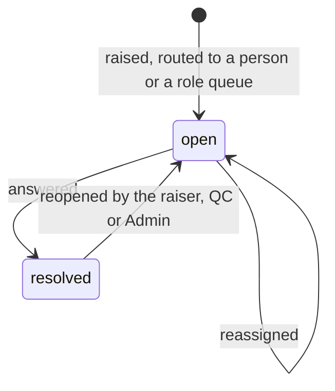

### Sync status

`ProjectSyncStatus` with [request_jira_sync.py](../../server/app/modules/stories/usecases/request_jira_sync.py) and [sync_jira_project.py](../../server/app/modules/stories/usecases/sync_jira_project.py). Spec: [STORY-4](../spec/sprints-and-stories.md#story-4-sync-from-jira-wbs-354).

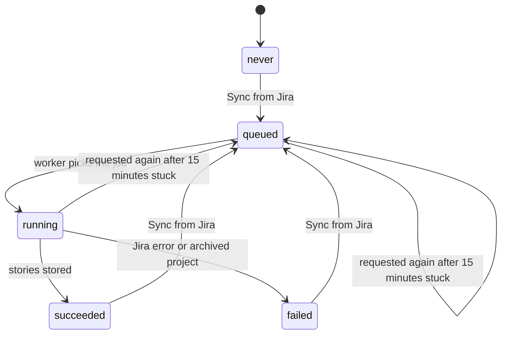

### User status

`UserStatus` with the invite, accept, deactivate and reactivate use cases in [server/app/modules/auth/usecases](../../server/app/modules/auth/usecases). Spec: [USER-2](../spec/user-management.md#user-2-invite-a-user-wbs-33b1), [USER-4](../spec/user-management.md#user-4-deactivate-and-reactivate-wbs-33b1).

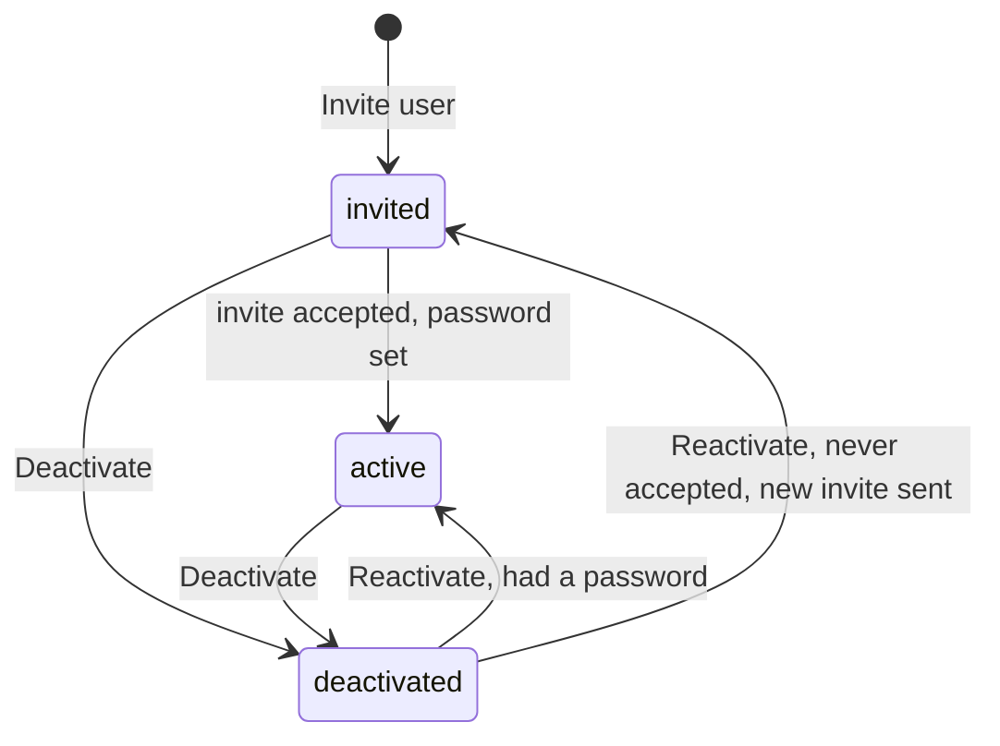

## Differences from the specs and proposals

- WBS 2.5 ends onboarding at the dashboard. In code, after the recovery codes the user goes to `/`, which opens the last or first project, or `/projects` when the user is in no project yet.
- The Claude run calls `record_case_result` once per case, not a step-by-step `record_step_result` as in the [workflow proposal §6](../discussions/testing-workflow-proposal.md#6-claude-integration-mcp-server).
