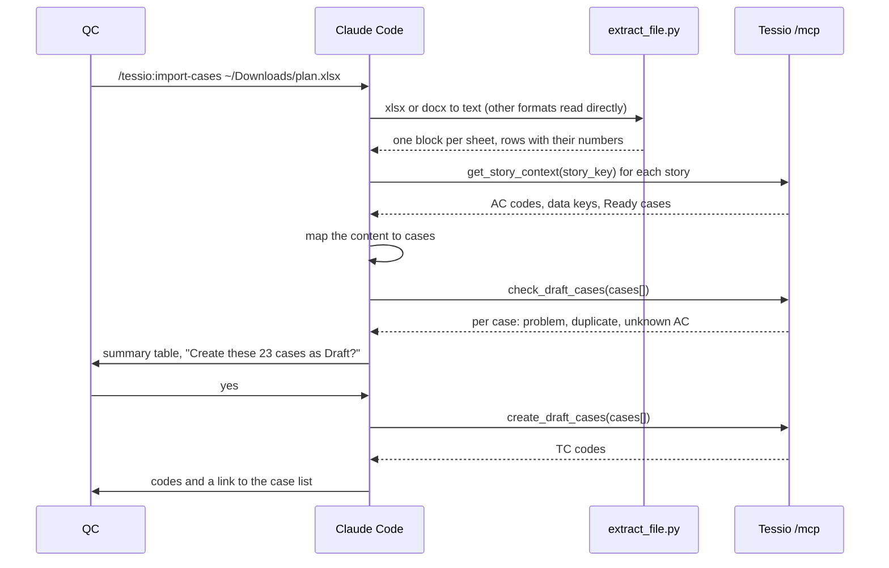

# Claude drafts test cases: from any file, or from the AC

**Status:** Accepted, built on 2026-11-01 (what the code does is in the [test-cases spec, CASE-10 and CASE-11](../spec/test-cases.md#case-10-claude-imports-cases-from-any-file-wbs-369-58-59))
**Date:** 2026-11-01
**WBS:** [3.6.8](../wbs/wbs.md#36-test-cases) (draft from AC), [3.6.9](../wbs/wbs.md#36-test-cases) (import any file), [5.8](../wbs/wbs.md#5-claude-integration) (MCP tools), [5.9](../wbs/wbs.md#5-claude-integration) (skills and helper script)
**Related:** [test-cases spec, CASE-9](../spec/test-cases.md#case-9-import-from-a-spreadsheet-wbs-367) (the rule-based import), [Tessio plugin](../../claude/README.md), [server proposal §8](server-proposal.md#8-mcp-tools) (MCP tools)

## Decisions at a glance

| Area | Decision |
| --- | --- |
| Where Claude runs | **In Claude Code on the user's machine**, through the Tessio plugin, signed in with the user's own Claude plan. The server never calls Claude, so there is no API key and no AI bill on the server. |
| Entry points | Two plugin skills: `/tessio:import-cases <file> [STORY-KEY]` and `/tessio:draft-cases <STORY-KEY>`. |
| Files Claude can read | `.xlsx`, `.csv`, `.docx`, `.pdf`, `.txt`, `.md`, and images (PNG, JPEG) of a sheet or a plan. |
| Status of new cases | **Always Draft.** QC reviews every case before it can reach Ready and run. |
| Who can use it | Admin and QC (`test_case.edit`), the same people who can import today. |
| Server checks | **The same checks as the web import preview**: story found, step limit, text length, duplicate title, unknown AC codes. |
| Confirmation | Claude shows a summary and creates nothing until the user says yes. |
| The web import | **Stays as it is.** It is cheap and predictable when a sheet matches its columns. |

## 1. Why

The web import ([CASE-9](../spec/test-cases.md#case-9-import-from-a-spreadsheet-wbs-367)) only reads an `.xlsx` or `.csv` whose headers match a fixed list. That list is a guess, because no real sheet has arrived (blockers B-7 and B-9). Real QC files break it: merged cells, all steps in one cell, steps and expected results mixed, odd headers, Word or PDF test plans.

Claude can read the file the way a person does and turn it into Tessio's case shape. The server keeps the final say: it checks every case with the rules it already has.

The same tools let Claude write cases from a story's AC when no file exists (WBS 3.6.8).

## 2. How it fits

## 3. MCP tools (WBS 5.8)

Both tools work in the token's project, like `raise_gaps`. They need `test_case.edit`, so PM, BA, Dev and Viewer tokens get `PERMISSION_DENIED`. On an archived project both tools get `PROJECT_ARCHIVED`, the check included, like the web import preview.

### 3.1 Case input

Every case Claude sends has this shape. It mirrors the server's `ImportedCase` entity.

| Field | Type | Rule |
| --- | --- | --- |
| `story_key` | string | Required. The Jira key, upper-cased by the server. |
| `title` | string | 1 to 200 characters. |
| `priority` | `critical`, `high`, `medium`, `low` | Optional, `medium` by default. |
| `business_value` | string? | Up to 5000 characters. |
| `preconditions` | string? | Up to 5000 characters. |
| `steps` | `[{action, expected?}]` | 1 to 100 steps, in order. Each text up to 5000 characters. |
| `criterion_codes` | string[] | AC codes like `AC2`. Unknown codes are reported, not linked. |
| `source` | string | Where the case came from, up to 200 characters: `Sheet SHOP-12, rows 4-9`, `page 3`, or `AC2` for a case drafted from the AC. Shown in the check result only. |

At most **100 cases per call**. Claude splits a bigger file into several calls, story by story.

### 3.2 `check_draft_cases(cases[])`

Read-only. It runs the web import's plan logic (`load_case_import_plan` and `build_preview_items` in `server/app/modules/test_cases/utils/`) on the cases Claude sent, instead of on a parsed file.

It returns `case_count`, `creatable_count`, and only the cases that have an issue, each with:

| Field | Meaning |
| --- | --- |
| `index` | Position in the input. |
| `source` | Echoed from the input, so Claude can point at the file. |
| `problem` | `story_key_missing`, `story_not_found`, `too_many_steps`, `text_too_long`, or `null`. Same `CaseImportProblem` values as the web import. |
| `is_duplicate` | A case with the same title (ignoring case) already exists on that story, or appears earlier in the call. |
| `unknown_criterion_codes` | Codes that are not current AC of the story. |

Cases without an issue are not listed, so a clean set of 100 cases costs a few tokens.

### 3.3 `create_draft_cases(cases[])`

Re-runs the same checks in one transaction, then creates the cases as `draft`, like the web import's commit:
- each case gets the next `TC-<n>` code;
- each case gets version 1, created by the token owner;
- the AC that exist are linked;
- a `test_case.changed` live event fires after the commit.

- **All or nothing:** if any case has a `problem`, the whole call is refused with `INVALID_REQUEST` and nothing is created. Claude drops or fixes that case and calls again.
- Duplicates are allowed, as in the web import, because the user confirmed them.
- It returns only the new codes, in input order: `{"codes": ["TC-4", "TC-5"]}`.

### 3.4 Code changes on the server

- `load_case_import_plan` takes a list of `ImportedCase` instead of a `ParsedCaseImport`, so a parsed file and Claude's cases share one path.
- One new use case per tool in `modules/test_cases/usecases/`, both with `execute_in_token_project`, like the gaps tools.
- `modules/test_cases/mcp_tools.py` registers both tools, with descriptions in `typing/constants/`. `Container.mcp_server` registers the module.
- Wire models for the case input in `modules/test_cases/models/`.

## 4. Skills (WBS 5.9)

Both skills live in `claude/skills/`. `import-cases` pre-approves `mcp__plugin_tessio_tessio__*`, `Read` and `Bash(python3 ${CLAUDE_PLUGIN_ROOT}/scripts/extract_file.py *)`; `draft-cases` only the Tessio tools.

### 4.1 `/tessio:import-cases <file> [STORY-KEY]`

1. Read the file:
   - `.xlsx` and `.docx` go through `extract_file.py` (§4.3);
   - `.csv`, `.txt`, `.md`, `.pdf` and images are read directly.
2. Find the stories, in this order: the `STORY-KEY` argument, then a Story column, then the sheet tab names, then headings that hold a Jira key. A case with no story is reported, not guessed.
3. Call `get_story_context` once per story, for its AC codes and data keys.
4. Map the content to cases with the rules in §5.
5. Call `check_draft_cases`. Fix only what the source makes clear, such as a story key typed in lower case. Leave the rest as problems.
6. Show the user a summary:
   - for each story, the number of cases, plus the problems, duplicates and unknown AC with their `source`;
   - the `{{data.key}}` placeholders that need a value in Test data (§5).
7. Ask "Create {n} cases as Draft?" Duplicates are left out unless the user keeps them.
8. Call `create_draft_cases` and report the codes, with a link to `/projects/<key>/test-cases?storyKey=<story>`.

### 4.2 `/tessio:draft-cases <STORY-KEY>`

1. Call `get_story_context`.
2. For each active AC, write one case for the expected behaviour, plus one for each failure or edge case the AC names. Each case links the AC it covers.
3. Use `{{data.key}}` for data the context already lists. Name new keys for missing data and report them.
4. Then steps 5 to 8 of §4.1. The `source` is the AC code.

### 4.3 `claude/scripts/extract_file.py`

- A Python script using only the standard library, like the upload hook, so `python3` 3.9 or later is enough.
- It unzips the file and reads the XML:
  - for `.xlsx`, it prints one block per sheet, with the tab name and every row as `row <n>: cell | cell | ...`, merged cells repeated;
  - for `.docx`, it prints the paragraphs and tables in order.
- It stops with a clear message above 5 MB or 5000 rows, the web import's limits.
- Tests in `claude/hooks/tests/`, run by the `claude-plugin` CI job.

## 5. Mapping rules for Claude

These rules go into both skills, word for word.

- **Keep the author's words.** Don't rewrite, translate or improve steps. Split a cell into steps only where the source numbers them or puts them on separate lines.
- **Never invent.** A step without an expected result keeps an empty `expected`. A missing priority becomes `medium`. AC codes come only from the source (for import) or from the AC being drafted (for draft-cases).
- **No secrets in case text.** A password, token or key found in the file is replaced with `{{data.<key>}}` and listed for QC to add in Test data. The value is never sent to Tessio or repeated in chat.
- **Files:** a step that uploads a file keeps its words. QC attaches the file later on the case's Files tab.
- **Never touch existing cases**, Jira or test data. The skills only create Draft cases.

## 6. Limits and errors

| Limit | Value |
| --- | --- |
| Cases per tool call | 100 |
| Cases per skill run | 500 (`MAX_IMPORTED_CASES`) |
| File for `extract_file.py` | 5 MB, 5000 rows |
| Case fields | The CASE-2 limits: title 200, texts 5000, 100 steps, 50 AC links |

| ErrorCode | When |
| --- | --- |
| `INVALID_API_TOKEN` | Bad, expired or revoked token |
| `PERMISSION_DENIED` | The token's role has no `test_case.edit` |
| `PROJECT_ARCHIVED` | Either tool on an archived project |
| `INVALID_REQUEST` | More than 100 cases, a field outside its limits, or `create_draft_cases` with a case that has a problem |

## 7. Not in this proposal

- **A "drafted by Claude" mark on the case.** The case history shows the token owner as the author, and every case starts as Draft. A mark can come later if QC asks for it.
- **Running the AI from the web app.** That would need an API key on the server. It was ruled out on 2026-11-01.
- **Updating existing cases from a newer version of the file.**
- **Attaching test files during import.**

## 8. Open points

- **No real QC file to test the mapping on.** The skills are written from the rules above and need one pilot file before they're called done (B-7, B-9).
- **Tokens per imported case are not measured.** A large sheet is mostly text, so it should cost far less than a run with screenshots.
