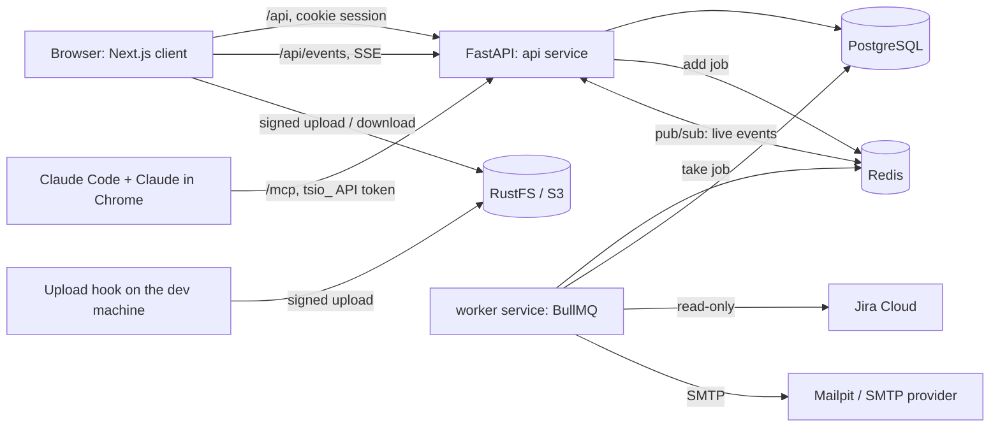
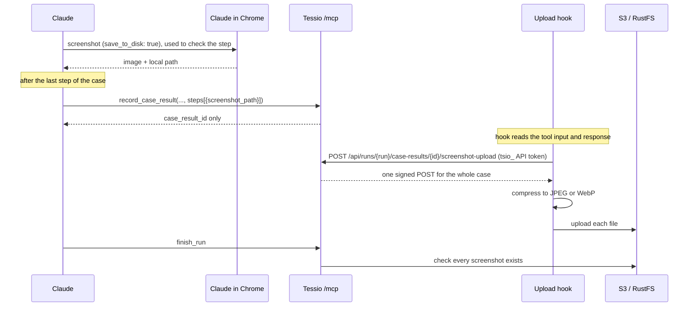

# Proposal: Tessio server

**Status:** Accepted. The stack is recorded in [ADR 0004](../decisions/0004-backend-stack.md); the numbers and rules are in §15. The spikes in §16 come before building. Where the built code differs, the [functional specs](../spec/README.md) and this corrected text describe the code. Updated 2026-11-01.
**Date:** 2026-10-31
**Related:** [testing-workflow-proposal.md](testing-workflow-proposal.md) (workflow, domain model, roles) · [platform-features-proposal.md](platform-features-proposal.md) (auth, projects, users, files) · [WBS §4 and §5](../wbs/wbs.md)

## 1. What the server does

- Stores everything Tessio owns: test cases, test data, runs, results, failures, gaps.
- Syncs sprints, stories and AC from Jira Cloud, read-only.
- Serves the web client (REST + live events) and Claude (MCP), with the **same rules** behind both.
- Hands out short-lived links for files. Files go straight between the browser or the Claude hook and S3, never through the API.

It **never runs a browser.** Claude drives the real application in Chrome (Claude in Chrome) on the developer's machine, and testers run manual cases by hand. Tessio only stores what they report.



## 2. Stack

| Concern | Choice |
| --- | --- |
| Language and tooling | Python 3.14, `uv`, `ruff`, `mypy --strict` (no `Any`), `pytest`, `import-linter` |
| Web framework | FastAPI on uvicorn, settings with `pydantic-settings` |
| Database | PostgreSQL 17+, SQLAlchemy 2 (async, `asyncpg`), Alembic migrations |
| IDs | UUIDv7 (`uuid.uuid7()`, new in Python 3.14): time-ordered, safe to show in URLs |
| Background jobs | Redis + `bullmq` (Python), periodic jobs through BullMQ Job Schedulers ([ADR 0006](../decisions/0006-background-jobs-redis-bullmq.md)) |
| MCP server | Official `mcp` Python SDK, Streamable HTTP, mounted in the same app at `/mcp` |
| Live updates | Server-sent events, fed by Redis pub/sub (the Redis that also runs BullMQ, [ADR 0006](../decisions/0006-background-jobs-redis-bullmq.md)) |
| Auth | Own code: `argon2-cffi` (Argon2id), `pyotp` (TOTP), sessions in Postgres |
| Encryption | `cryptography` AES-256-GCM (secrets, TOTP keys, Jira token) |
| Files | `boto3` signed POST / GET links; RustFS locally and on the VPS ([ADR 0005](../decisions/0005-local-object-storage.md), [ADR 0009](../decisions/0009-production-storage-and-proxy.md)) |
| Email | `aiosmtplib`, sent by the worker; Mailpit locally, an SMTP provider in production (not chosen yet) |
| Jira | `httpx` against Jira Cloud REST API v3 and the Agile API |
| Client contract | FastAPI's OpenAPI spec → `openapi-typescript` types in the client; fetch hooks stay hand-written |

## 3. Code layout

Same shape as our existing Python service, so the conventions in the `coding-standard` skill apply as they are. The layout below is the one in the code; [server/README.md](../../server/README.md) describes how to add to it.

```
server/
├── pyproject.toml · uv.lock · alembic.ini · Dockerfile · .env.example
├── migrations/                  Alembic versions (0001 to 0014)
├── app/
│   ├── main.py                  create_app(container), create_production_app(): REST routers + /mcp
│   ├── container.py             composition root: the only place that wires adapters, use cases, MCP tools and jobs
│   ├── config/settings.py       one <Concern>Settings class per concern, read from the environment
│   ├── commands/                invite_user, export_openapi, jira_probe, seed_e2e
│   ├── workers/worker.py        BullMQ worker entrypoint: python -m app.workers.worker
│   ├── api/                     error_handlers, error_response, origin_check: cross-module HTTP pieces, not routers
│   ├── modules/<module>/
│   │   ├── router.py            routes: unpack input, call one use case; extra routers such as
│   │   │                        auth/users_router.py, auth/me_router.py, runs/manual_router.py
│   │   ├── dependencies.py      FastAPI dependencies (use cases from the container, current session)
│   │   ├── mcp_tools.py         register_<module>_tools: MCP tools calling the same use cases (runs, gaps, story_context)
│   │   ├── mcp_dependencies.py  API-token authentication for MCP calls (api_tokens)
│   │   ├── job_handlers/        BullMQ job handlers (auth, files, runs, stories)
│   │   ├── usecases/            one operation each, `async execute`
│   │   ├── domains/<name>/      entity + repository port (ABC)
│   │   ├── ports/               other ABC ports the use cases depend on
│   │   ├── infrastructure/      SQLAlchemy tables, Postgres repositories, adapters and clients
│   │   ├── models/              request / response models (WireModel, camelCase)
│   │   ├── utils/               pure helpers
│   │   ├── typing/              enums/ and constants/
│   │   └── errors.py            <What>Error(TessioError)
│   └── shared/                  common, crypto, events, logging, mailer, masking, permissions, postgres,
│                                queue, rate_limit, storage, typing
└── tests/                       api (per module, plus app, openapi and security), unit, permissions, queue,
                                 fakes, fixtures, support
```

There is no shared `auth` package: sessions and API tokens live in the `auth` and `api_tokens` modules. There is no `tests/architecture/` either: `import-linter` enforces the layers (`uv run lint-imports`).

| Module | Covers | WBS |
| --- | --- | --- |
| `users` | The `users` table and the `User` entity that `auth` builds on | 3.2, 3.3b (through `auth`) |
| `auth` | Sign-in, invites, 2FA, recovery codes, sessions, password reset, the profile (`me_router.py`) and the workspace users (`users_router.py`) | 3.1, 3.2, 3.3b |
| `projects` | Projects, members, archive, project settings, a user's project access | 3.1, 3.3, 3.3b, 3.13 |
| `files` | Stored files, signed uploads and downloads, avatars, the orphan clean-up job | 3.2, 3.6, 3.10, 3.14 |
| `audit` | The secret access log (`secret.reveal`, `secret.resolve`) | 3.9 |
| `notifications` | In-app notifications, unread count, read state | 3.1, 3.12 |
| `api_tokens` | Personal API tokens for Claude and their check on every MCP call | 3.2 |
| `jira` | The workspace Jira connection, the Jira client, project and board lookups | 3.3, 3.5, 3.13 |
| `test_data` | Environments, variables, endpoints, secrets, test data import | 3.9 |
| `stories` | Sprints, stories, AC, story test status, the Jira sync job and AC parser | 3.5, 3.7 |
| `test_cases` | Cases, versions, AC links, review flags, test files, case import | 3.6, 3.7 |
| `gaps` | Readiness review: gap questions over REST and MCP | 3.8 |
| `runs` | Claude and manual runs, case and step results, re-runs, reports, the stale-run job | 3.4, 3.10 |
| `failures` | Failure lifecycle and assignment | 3.11 |
| `story_context` | MCP `get_story_context`, `resolve_data` and `get_test_file` | 3.9, 3.10 |
| `insights` | Traceability, story progress, latest result per case, dashboard, my work | 3.4, 3.7 |
| `live_events` | `GET /api/events`, the server-sent event stream | 3.1, 3.12, 3.14 |
| `health` | `GET /api/health` and `GET /api/health/ready` | not in the spec index (operations, 7.4) |

The WBS ids come from the *Server module(s)* column of the [functional spec index](../spec/README.md). Two modules of the first plan were split: `jira_sync` became `jira` (connection, client) plus `stories` (sync job), and API tokens moved out of `auth` into `api_tokens`.

**Layers**, from `[tool.importlinter]` in `pyproject.toml`, lowest first. A module may import only modules in lower layers; modules on the same line never import each other.

users < auth < projects < files | audit | notifications < api_tokens | jira | test_data < stories < test_cases < gaps < runs < failures < story_context | insights < live_events | health

## 4. Authentication

### Flows

| Flow | Steps |
| --- | --- |
| **Invite** | Workspace admin enters email + workspace role → user created as `invited` → email with a one-time link → set password → scan TOTP QR code → confirm one code → 10 recovery codes shown once → signed in. |
| **Sign in** | Email + password → a *half* session (valid 10 minutes, can only call the 2FA endpoint) → TOTP code or a recovery code → full session. |
| **Forgot password** | Email link valid 30 minutes → new password → every session revoked → normal sign-in with 2FA. |
| **Admin resets 2FA** | TOTP key and recovery codes cleared, sessions revoked → user sets up 2FA again at next sign-in. |
| **Sign out of all devices** | Every session of the user deleted. |
| **Deactivate** | Sessions deleted; API tokens stop working because every check reads the user's status. |

### Rules

- **Passwords:** at least 12 characters; checked against the HaveIBeenPwned range API (only the first 5 characters of the SHA-1 hash leave the server; if the API is down, the check is skipped and logged). Hashed with Argon2id.
- **TOTP:** key stored encrypted; codes accepted one step either side; the last used time step is stored so a code can't be replayed.
- **Recovery codes:** stored hashed, each usable once.
- **Sessions:** random 32-byte token in a `tessio_session` cookie (`HttpOnly`, `Secure`, `SameSite=Lax`, kept by the browser for 30 days); the database stores only its SHA-256 and decides validity: expires after 7 days without activity, `last_seen_at` is updated at most once a minute. The token is replaced when two-factor succeeds, so a half-session token can never become a full one.
- **CSRF:** `SameSite=Lax` plus an `Origin` check on every non-GET request.
- **Lockout:** see §15 for the numbers. Error messages never say whether the email exists.
- **One-time links** (invite, reset): random, stored hashed, single use.

### Personal API tokens (Claude / MCP)

- Created in the profile for **one project**, with a name and an expiry date. Shown once, as `tsio_<8-char prefix>_<secret>`; stored as SHA-256 plus the prefix (so the UI can list them).
- Sent as a `tsio_` API token in `Authorization: Bearer tsio_…` on `/mcp`. Connected by installing the Tessio plugin; see the [Claude setup guide](../guides/claude-setup.md).
- Every call checks: token not expired or revoked → user active → still a member of the token's project → **the member's current role** allows the tool. A demoted user's token loses rights immediately.

## 5. Authorization

- **One permission table in code** (`shared/permissions`): project role → set of capabilities (`test_case.edit`, `secret.reveal`, `secret.use_in_run`, `run.start`, `failure.assign`, `failure.mark_fixed`, `failure.verify`, `story.mark_passed`, …). It is a direct copy of the tables in the [workflow proposal §5](testing-workflow-proposal.md) and the [platform proposal §2](platform-features-proposal.md).
- **One check per use case:** each use case declares the capability it needs, so REST routes and MCP tools are checked by the same code. Hiding a button in the client is only a convenience.
- **Project isolation:** every project-scoped table has `project_id`; every repository method takes it. A non-member gets **404**, never 403, so they can't tell the project exists. Workspace admins see every project.
- **Archived projects:** every write capability is refused; reads still work.
- **Tests:** one test per role × capability, generated from the permission table (WBS 6.3).

## 6. Database

Conventions: UUIDv7 primary keys, `created_at` / `updated_at` as `timestamptz`, enums stored as text with a check constraint, soft states (`archived_at`, `deactivated_at`) instead of deletes for anything history points to. The tables below match migrations `0001` to `0014`; `id`, `created_at` and `updated_at` are left out. `project_sync_states`, `test_case_counters` and `test_case_criteria` have no `id`: their foreign keys are the primary key.

### Workspace and access

| Table | Key columns |
| --- | --- |
| `users` | email (unique, case-insensitive), name, workspace_role (`owner` / `admin` / `member`), status (`invited` / `active` / `deactivated`), password_hash, totp_key_encrypted, totp_confirmed_at, totp_last_time_step, failed_sign_ins, locked_until, language (`en` / `fr` / `vi`), color_scheme (`light` / `dark` / `auto`), avatar_file_id, deactivated_at |
| `recovery_codes` | user_id, code_hash, used_at |
| `sessions` | user_id, token_hash, user_agent, ip, last_seen_at, expires_at, is_two_factor_passed |
| `one_time_tokens` | user_id, purpose (`invite` / `password_reset`), token_hash, expires_at, used_at |
| `api_tokens` | user_id, project_id, name, prefix, token_hash, expires_at, last_used_at, revoked_at |
| `jira_connection` | One row (`id = 1`): site_url, account_email, api_token_encrypted, account_id, account_display_name, configured_by, configured_at |
| `projects` | key (unique, e.g. `SHOP`), name, description, jira_project_key (unique), jira_board_id, allowed_file_types, archived_at, default_environment_id |
| `project_members` | project_id, user_id, role (`admin` / `pm` / `ba` / `qc` / `dev` / `viewer`); one row per user per project |
| `project_sync_states` | project_id (primary key), status (`never` / `queued` / `running` / `succeeded` / `failed`), requested_by, queued_at, started_at, finished_at, last_succeeded_at, error_code |

### Jira-synced (read-only in Tessio)

| Table | Key columns |
| --- | --- |
| `sprints` | project_id, jira_sprint_id, name, state (`active` / `future` / `closed`), start_at, end_at, complete_at, synced_at |
| `stories` | project_id, sprint_id, jira_id, jira_key, jira_url, title, description (Jira's document JSON), jira_status, jira_issue_type, **test_status** (owned by Tessio: `not_started` / `ready_for_test` / `in_test` / `passed` / `failed`), test_status_changed_at, test_status_changed_by, jira_updated_at, synced_at, jira_missing_at |
| `acceptance_criteria` | story_id, position, code (`AC1`…), text, removed_at |

### Test design

| Table | Key columns |
| --- | --- |
| `test_cases` | project_id, story_id, number (shown as `TC-{number}`), title, priority (`critical` / `high` / `medium` / `low`), status (`draft` / `in_review` / `ready` / `deprecated`), current_version_id, status_changed_at, status_changed_by, needs_review_at, needs_review_criterion_ids, reviewed_at, reviewed_by, created_by |
| `test_case_counters` | project_id (primary key), last_number: the next case number per project |
| `test_case_versions` | test_case_id, number, title, priority, business_value, preconditions, steps (JSONB: order, action, expected), criterion_ids, data_keys, file_version_ids, created_by. **Never updated:** every save adds a version. |
| `test_case_criteria` | test_case_id, criterion_id: the *current* links, for the traceability matrix |
| `test_files` | project_id, test_case_id, key (used as `{{file.key}}`), current_version_id, created_by |
| `test_file_versions` | test_file_id, number, stored_file_id, created_by |
| `environments` | project_id, name, base_url, health_check_url, archived_at |
| `test_data` | project_id, environment_id (empty = all environments), key, kind (`variable` / `endpoint` / `secret`), value (empty for secrets), value_encrypted. An environment row overrides the project-wide row with the same key. |
| `gaps` | project_id, story_id, target_type (`story` / `criterion` / `test_case`), target_id, type (`missing_ac` / `unclear_goal` / `missing_step` / `missing_test_data` / `other`), data_scope (`project` / `environment`), severity (`high` / `medium` / `low`), question, status (`open` / `resolved`), assignee_id, assignee_role, raised_by, raised_via_token_id, answer, answered_by, answered_at, reopened_by, reopened_at |

### Execution

| Table | Key columns |
| --- | --- |
| `runs` | project_id, story_id, environment_id, executor (`claude` / `manual`), status (`running` / `passed` / `failed` / `aborted`), abort_reason (`no_results` / `inactive`), parent_run_id, started_by, started_via_token_id, summary, report (JSONB), started_at, last_activity_at, finished_at |
| `run_cases` | run_id, test_case_id, test_case_version_id, position: the cases a run executes, at their fixed version |
| `run_files` | run_id, test_case_id, test_file_version_id, key, requested_by: the test file versions handed out by `get_test_file` |
| `case_results` | run_id, test_case_id, test_case_version_id, status (`passed` / `failed` / `blocked` / `skipped`), duration_ms, recorded_by |
| `step_results` | case_result_id, step_order, status, actual_result, error, screenshot_file_id, evidence_file_id |
| `failures` | project_id, story_id, test_case_id, opened_by_case_result_id, latest_case_result_id, assignee_id, status (`open` / `fixed` / `verified` / `reopened`), status_changed_at, status_changed_by |
| `failure_events` | failure_id, kind (`opened` / `failed_again` / `status_changed` / `assigned` / `unassigned`), from_status, to_status, case_result_id, assignee_id, actor_id |

### Files, notifications, audit

| Table | Key columns |
| --- | --- |
| `stored_files` | project_id, kind (`screenshot` / `test_file` / `evidence` / `import` / `avatar` / `report`), object_key, file_name, content_type, size, sha256, status (`pending` / `uploaded` / `missing`), uploaded_by |
| `notifications` | user_id, project_id, actor_id, kind (`gap_assigned` / `failure_assigned` / `run_finished`), payload (JSONB), read_at |
| `audit_events` | actor_id, api_token_id, project_id, action (`secret.reveal` / `secret.resolve`), target_id, run_id |

## 7. REST API

All under `/api`, JSON in camelCase, generated into the OpenAPI spec. Project routes use the project key: `…` below stands for `projects/{project_key}`. The OpenAPI document ([client/src/lib/api/openapi.json](../../client/src/lib/api/openapi.json), written by `python -m app.commands.export_openapi`) is the source of truth; this table is a map of it.

| Area | Endpoints |
| --- | --- |
| Auth | `POST auth/sign-in` · `POST auth/two-factor` · `POST auth/two-factor/setup` · `POST auth/two-factor/confirm` · `GET auth/me` · `POST auth/sign-out` · `POST auth/sign-out-all` · `POST auth/invites/{token}` (set password) · `POST auth/password/forgot` · `POST auth/password/reset` |
| Profile | `PATCH me` · `PUT me/password` · `POST me/recovery-codes` (a new set) · `POST me/two-factor/reset` · `POST me/avatar-upload` · `POST me/avatar-upload/{file_id}/complete` · `GET/POST me/api-tokens` · `DELETE me/api-tokens/{token_id}` |
| Workspace | `GET/POST users` (POST = invite) · `GET users/{user_id}` · `POST users/{user_id}/resend-invite` · `POST users/{user_id}/deactivate` · `POST users/{user_id}/reactivate` · `POST users/{user_id}/reset-two-factor` · `PUT users/{user_id}/workspace-role` · `GET users/{user_id}/avatar` · `GET users/{user_id}/access` · `GET/PUT workspace/jira` · `GET workspace/jira/projects` · `GET workspace/jira/boards` |
| Projects | `GET/POST projects` · `GET/PATCH projects/{project_key}` · `POST …/archive` · `POST …/unarchive` · `GET …/members` · `GET …/members/candidates` · `PUT/DELETE …/members/{user_id}` |
| Stories | `GET/POST …/sync` (sync state / start a sync) · `GET …/sprints` · `GET …/sprints/{sprint_id}` · `GET …/stories` · `GET …/stories/{jira_key}` · `PUT …/stories/{jira_key}/test-status` |
| Test cases | `GET/POST …/test-cases` · `GET/PATCH …/test-cases/{case_code}` (a save adds a version) · `GET …/test-cases/{case_code}/versions` · `PUT …/test-cases/{case_code}/status` · `POST …/test-cases/{case_code}/review` · `POST …/test-cases/{case_code}/files` · `GET …/test-cases/{case_code}/files/{file_key}/versions` · `POST …/test-case-imports/preview` · `POST …/test-case-imports/commit` (Sheets / CSV) |
| Files | `POST …/uploads` (returns a signed upload) · `POST …/uploads/{file_id}/complete` · `GET …/files/{file_id}` (returns a signed download link) · `POST runs/{run_id}/case-results/{case_result_id}/screenshot-upload` (API token, used by the upload hook) |
| Test data | `GET/POST …/environments` · `PUT/DELETE …/environments/{environment_id}` · `POST …/environments/{environment_id}/archive` · `POST …/environments/{environment_id}/unarchive` · `GET/POST …/test-data` · `GET …/test-data/effective` · `POST …/test-data/import/preview` · `POST …/test-data/import/commit` · `PUT/DELETE …/test-data/{item_id}` · `POST …/test-data/{item_id}/reveal` (audited) |
| Gaps | `GET …/gaps` (filter: mine, story, status) · `POST …/stories/{jira_key}/gaps` · `GET …/gaps/{gap_id}` · `PUT …/gaps/{gap_id}/answer` · `POST …/gaps/{gap_id}/reopen` · `PUT …/gaps/{gap_id}/assignee` · `GET gaps/inbox` |
| Runs | `GET/POST …/runs` (POST = manual run) · `GET …/runs/{run_id}` · `PUT …/runs/{run_id}/cases/{test_case_id}` (manual results) · `POST …/runs/{run_id}/finish` · `POST …/runs/{run_id}/rerun-failed` |
| Failures | `GET …/failures` (filter: status, assignee, `unassigned`, story, case) · `GET …/failures/{failure_id}` · `PUT …/failures/{failure_id}/status` · `PUT …/failures/{failure_id}/assignee` |
| Insights | `GET …/stories/{jira_key}/traceability` · `GET …/story-progress` · `GET …/case-latest-results` · `GET …/dashboard` · `GET …/my-work` |
| Live | `GET events` (SSE, one stream per signed-in user) · `GET notifications` · `GET notifications/unread-count` · `PUT notifications/read-all` · `PUT notifications/{notification_id}/read` |
| Health | `GET health` (the process is up) · `GET health/ready` (Postgres and Redis answer) |

## 8. MCP tools

These replace the list in the [workflow proposal §6](testing-workflow-proposal.md). The main change is **one result call per test case** instead of one per step. Replies are short JSON and never repeat what Claude sent. Arguments are snake_case, as in `modules/{runs,gaps,story_context}/mcp_tools.py`; `?` marks an optional argument.

| Tool | Purpose |
| --- | --- |
| `get_story_context(story_key)` | Story, AC, the *Ready* cases at their current version, steps, non-secret data values, file keys. Secrets appear only as `{{data.key}}`. |
| `raise_gaps(story_key, gaps[])` | Files gap questions, routed by type; returns their IDs and whether the story is ready. |
| `get_open_gaps(story_key)` | What is still unanswered. |
| `start_run(story_key, environment?, case_ids?, parent_run_id?)` | Creates the run; returns run ID, case versions, base URL and health-check URL. Refused while any gap is open. Without `environment`, the parent run's, the project default or the only active environment is used. |
| `resolve_data(run_id, keys[])` | Secret values, only for the caller's own running run; every call is audited. |
| `get_test_file(run_id, key, case_id?)` | A short-lived download link and file name; Claude downloads it with `curl` and attaches it with Claude in Chrome's `file_upload`. `case_id` picks the case when several cases use the same key. |
| `record_case_result(run_id, case_id, status, duration_ms, steps[])` | Each step: order, status, actual result, error, `screenshot_path`. Returns only the case result ID (about 30 tokens); the hook fetches the upload link itself (§9). |
| `finish_run(run_id, summary?)` | Closes the run, builds the report, returns the run status and any step whose screenshot never arrived. |
| `get_failed_cases(run_id)` | Input for "re-run failed only". |

Before the first case, Claude calls the environment's health-check URL itself (WBS 5.4): only the developer's machine is sure to reach the dev environment. If it is down, Claude ends the run with `finish_run` and the reason.

## 9. Screenshots and files

### Claude runs: zero model tokens for the image



- The **hook** is the plugin hook [claude/hooks/upload_screenshots.py](../../claude/hooks/upload_screenshots.py), a `PostToolUse` hook on `mcp__plugin_tessio_tessio__record_case_result` (WBS 5.5). It reads the plugin options `CLAUDE_PLUGIN_OPTION_TESSIO_URL` and `CLAUDE_PLUGIN_OPTION_TESSIO_TOKEN`, with `TESSIO_URL` / `TESSIO_TOKEN` as the fallback, asks Tessio for one signed POST per case (its key prefix covers every step), uploads Claude in Chrome's screenshots as they are (they are already JPEG, about 46 KB at 1400 × 845), compresses any other format (`sips` to JPEG on macOS, `cwebp` to WebP elsewhere) and uploads with `curl`.
- **Why the hook fetches the link itself** (spike 1.7.2): Claude Code shows the model both the text and the structured part of a tool result, so links returned by the tool would cost about 350 tokens per case. Links in the result's `_meta` are hidden from the model but also from the hook.
- If an upload fails, the hook appends it to `~/.tessio/pending-uploads.jsonl` and retries it on its next run. `finish_run` marks screenshots still missing as `missing` and lists them.
- The evidence screenshot is the one Claude already takes to check the step's expected result, so a run takes no extra screenshots.

### All files

- **Bucket is private.** Object keys: `projects/{projectId}/{kind}/{fileId}`.
- **Uploads use signed POST** (not PUT), so the storage itself enforces the 20 MB limit and the content type. The API checks the project's allowed file types before signing.
- **Downloads use signed GET links** valid for 5 minutes, issued only after the permission check.
- **Kept forever:** screenshots are never deleted. A 90-day lifecycle rule for screenshots is planned but not set up on RustFS (see [deploy/README.md](../../deploy/README.md#not-decided-yet), "Not decided yet"). It is a bucket setting, not code.
- **Orphans:** a daily job deletes `pending` uploads older than a day.

## 10. Runs, failures and live updates

- **Start:** only from a story with no open gap; the run records each case's version. The story moves to *In test* on its first run.
- **Results:** a case result is written once, by `record_case_result` (Claude) or by the manual-run screen (tester).
- **Finish:** run status = `failed` if any case failed or was blocked, else `passed`. The report is built from the data: counts, failed cases with their step, and AC impact via the case–AC links. Claude's summary is added to it.
- **Re-run failed only:** a child run with `parent_run_id`, made of the parent's failed and blocked cases.
- **Latest result per case:** a case's current status (for the traceability matrix, AC status and the story view) is its most recent recorded result in any run. A run that has no result for a case (a re-run of failed cases only, or a run that stopped early) leaves that case's previous result in place.
- **Failures:** a failed case opens a failure (or updates the open one for that case), **unassigned**. Someone assigns it by hand (§15), which notifies the assignee. Dev marks *Fixed*. A later failed result on a *Fixed* failure reopens it automatically. QC marks *Verified*.
- **Stale runs:** a periodic job marks runs with no activity for 4 hours as `aborted`. Cases the run never reported keep their previous result, as above.
- **Masking:** before saving, the summary, actual results and errors are scanned for the run's resolved secret values, which are replaced with `••••`.
- **Live updates:** each write publishes a small message (event type + IDs) on a Redis pub/sub channel. Every API instance subscribes and forwards it to the open `/api/events` streams of users who can see that project. The client then refetches. It carries run progress (one event per case), run finished and notifications.

## 11. Jira sync

- **Connection:** one per workspace, set by a workspace admin: site URL, the email of a Jira user, and that user's personal API token (stored encrypted). Any Jira user can create the token at id.atlassian.com (Security → API tokens) without Jira admin rights; Tessio then sees exactly what that user sees. For MVP this is a team member's own account; later a dedicated read-only account, created by a Jira admin, so the sync does not depend on one person. Each project stores its Jira project key and board ID, picked from dropdowns filled from the connection.
- **When:** **only when a user clicks *Sync*.** There is no polling, no schedule and no webhook, so Tessio calls Jira only on demand. A new project shows "Never synced" until the first click. The click enqueues a job (deduplicated with a BullMQ job ID per project, so double clicks run once), and a live event refreshes the page when it finishes.
- **What:** the board's active, future and recently closed sprints, then the stories in them, with summary, description, status and sprint.
- **AC parsing:** Jira Cloud returns the description as a JSON document. The parser takes the list under a heading containing "Acceptance criteria" (or the first list if there is no such heading); each item becomes `AC1`, `AC2`… by position. When an AC's text changes, its linked test cases get a "AC changed, review" flag. An AC removed from Jira keeps its row with `removed_at`, so history stays readable.
- **Never writes to Jira.** Rate-limit replies (429) are retried with the delay Jira asks for.

## 12. Secrets

- **Encryption:** AES-256-GCM with a 32-byte key from `TESSIO_ENCRYPTION_KEY` (from the server's environment). Each ciphertext stores a key ID, so the key can be rotated. Envelope encryption with a managed key service is a later upgrade.
- **Who sees values:** project Admin and QC can reveal in the UI (audited). Dev gets values only through `resolve_data` during their own running run (audited). PM, BA and Viewer never see them.
- **Where values never appear:** API list responses, `get_story_context`, logs, reports.

## 13. Background jobs

Redis + BullMQ ([ADR 0006](../decisions/0006-background-jobs-redis-bullmq.md)). The API adds jobs through the `JobQueue` port; the worker (`python -m app.workers.worker`) runs them. Each job is retried 5 times with exponential backoff from 30 seconds; completed jobs are removed, failed jobs kept 7 days. Periodic jobs use BullMQ Job Schedulers (cron): `Container.job_schedules` lists them, and the worker replaces the schedulers with that list at start.

| Job | Queue | Trigger | Status |
| --- | --- | --- | --- |
| `jira.sync_project` | `jira` | *Sync* button only | ✅ |
| `email.send` | `email` | Invite, resend invite, password reset | ✅ |
| `runs.abort_stale` | `maintenance` | Every 15 minutes (`*/15 * * * *`) | ✅ |
| `files.delete_orphans` | `maintenance` | Daily at 03:00 (`0 3 * * *`) | ✅ |
| `sessions.delete_expired` | `maintenance` | Daily at 03:30 (`30 3 * * *`) | ✅ |

## 14. Local development and deployment

### Local

- `docker-compose.yml` at the repo root: `postgres`, `redis`, `bull-board` (job dashboard at http://localhost:3205), `rustfs` (+ a one-off container that creates the bucket), `mailpit`.
- Server: `uv run uvicorn app.main:create_production_app --factory --reload --port 3202` (API on port 3202) and `uv run python -m app.workers.worker` (the job worker). See [server/README.md](../../server/README.md).
- The client forwards `/api` and `/mcp` to `localhost:3202` through `rewrites` in `next.config.ts`, so cookies stay same-site.

### VPS (dev, staging, prod)

Decided in [ADR 0007](../decisions/0007-hosting-vps-docker.md) and [ADR 0009](../decisions/0009-production-storage-and-proxy.md); run book in [deploy/README.md](../../deploy/README.md).

- **Docker Compose on a rented VPS** ([compose.prod.yml](../../compose.prod.yml)): `caddy`, `client` (Next.js), `api` and `worker` (the same server image, different command), `postgres`, `redis`, `rustfs` (+ the one-off `rustfs-bucket` container that creates the bucket and its CORS rule), and `bull-board` (only with the `ops` profile, on `127.0.0.1:3205`).
- **Reverse proxy:** Caddy ([deploy/Caddyfile](../../deploy/Caddyfile)), with automatic TLS. `/api/*` and `/mcp` → `api`, with `flush_interval -1` and no compression so live events and MCP stream at once; everything else → `client`. Client and API share one origin, so the API needs no CORS. RustFS has its own domain, `STORAGE_DOMAIN`, with a bucket CORS rule for `https://$TESSIO_DOMAIN` so the browser can use the signed links.
- **Client IP:** uvicorn runs with `--proxy-headers --forwarded-allow-ips "*"`, so the rate limits see the real client IP. This is safe because `api` is reachable only through Caddy on the Docker network.
- **Not public:** Postgres, Redis and `api` stay inside the Docker network; only Caddy publishes ports (80 and 443).
- **Secrets:** from the server's environment (`.env` next to `compose.prod.yml`).
- **Migrations:** [deploy/deploy.sh](../../deploy/deploy.sh) runs `docker compose run --rm --no-deps api alembic upgrade head` before it starts the new version.
- **Still to choose:** the SMTP provider, backups, and the VPS provider and domain (see [deploy/README.md](../../deploy/README.md#not-decided-yet)).

## 15. Numbers and rules

Decided 2026-10-31, except where marked.

| # | Item | Decision |
| --- | --- | --- |
| 1 | Lockout | 5 failed sign-ins → locked 15 minutes |
| 2 | Invite link validity | 7 days |
| 3 | API token maximum lifetime | 90 days |
| 4 | Missing results | A case without a result in a newer run keeps its previous result. Runs idle for 4 hours are closed as `aborted`. |
| 5 | Jira sync | Only when a user clicks *Sync*; no polling |
| 6 | Which cases can run | Only *Ready* cases |
| 7 | Matching AC after a Jira edit | By position in the list, with an "AC changed, review" flag on linked cases |
| 8 | Failure assignee | None by default; assigned by hand. Project Admin, QC and Dev can assign any failure to any project member (capability `failure.assign`). PM, BA and Viewer cannot. |

## 16. Spikes before building

About one day each. Each one checks something not verified yet.

1. **Auth:** ✅ done 2026-11-01: invite → password → required TOTP → recovery code sign-in, end to end.
2. **Screenshot hook:** ✅ done 2026-11-01 for the hook. The hook receives `tool_input` and the text result; uploads reach storage; the tool result the model sees is 92 characters; a failed upload is retried on the next run. Claude in Chrome saves to `$TMPDIR/claude-chrome-screenshots-<random>/screenshot-<epoch-ms>-<n>.jpg` (mode 0600, readable by the hook as the same user); `scale: 0.5` saves a file half as wide and high (700 × 423, about 17 KB), so evidence screenshots must be taken at full scale.
3. **SSE through Next.js `rewrites`:** ✅ done 2026-11-01. Events arrive on time through the rewrite. Next.js gzips responses when the browser accepts it, and a gzipped stream holds every event back; `GET /api/events` therefore sends `Cache-Control: no-transform`, which Next.js (and well-behaved reverse proxies) respect. The production reverse proxy must be checked the same way (ADR 0007). Production: Caddy is configured with `flush_interval -1` and no `encode` on `/api/*`, not yet tested on a VPS.
4. **Jira:** issue search through the newer `/rest/api/3/search/jql` endpoint, and AC parsing on a real story description.

## 17. Token cost (Claude workflow)

- Most of a run's tokens are the screenshots Claude looks at (about 1,400 tokens each at full size, estimated). Tessio can't change that, but the workflow can: use `scale: 0.5` (about a quarter of the tokens) for screenshots taken only to find where to click, and full size only for the evidence screenshot of each step.
- Tessio's share is one `record_case_result` call per case, with the image sent as a path (about 20 tokens), not as image data.
