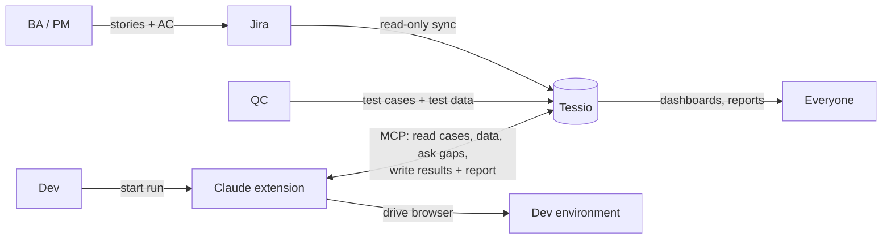
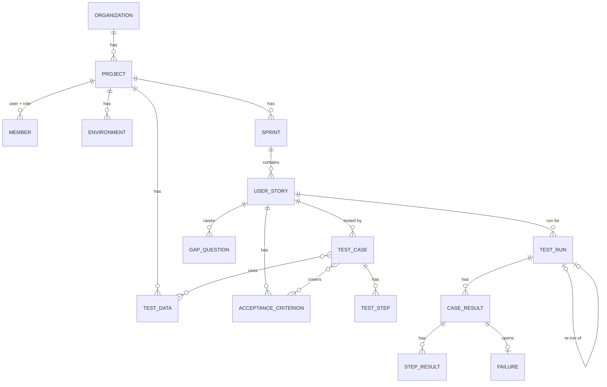

# Proposal: Tessio as the single home for the sprint testing workflow

**Status:** Accepted, with the decisions in §10.
**Date:** 2026-10-31

## 1. How we work today

| Step | Who | Where the data lives |
| --- | --- | --- |
| 1. Write the test plan at sprint start: one tab per user story, step-by-step test cases, each covering one or more acceptance criteria (AC) | QC | Google Sheets |
| 2. Feature done → start the automation workflow (skills, commands, hooks in the Claude extension), pointed at a URL with the test cases | Dev | Claude extension + sheet URL |
| 3. Pre-run review: Claude compares test cases with AC and asks about gaps (missing test data, AC, steps, unclear goals) | Claude + Dev | Chat session (lost afterwards) |
| 4. Claude runs the tests on the dev environment and writes a report | Claude | Report file |
| 5. Review the report, fix failures | Dev | Report file + code |
| 6. Re-run the failed cases to verify the fixes | Claude | New report file |
| — | Shared test data: usernames, passwords, site URLs, server health APIs | Everyone | A separate file |

### What hurts

- **Data in five places:** sheet, data file, chat Q&A, report files, Claude config.
- **No traceability:** you can't easily see which AC are covered, which are failing, or the history of a test case across re-runs.
- **Pre-run Q&A disappears:** answers to gap questions never make it back into the test cases, so the same gaps come back next time.
- **Credentials in a plain file:** shared with everyone, with no access control or audit.
- **Hard to see sprint progress:** PM/BA have to open sheets and report files to know where testing stands.

## 2. The proposal in one sentence

**Tessio stores everything about testing (test cases, test data, runs, reports and failures) and syncs user stories and AC from Jira, where they stay. Claude reads and writes through Tessio's MCP server instead of sheet URLs and files.**

The Claude workflow you already have stays. Its *source* and *destination* change from Google Sheets and files to Tessio.

## 3. The workflow inside Tessio

| # | Step | Who | In Tessio | Claude (via MCP) |
| --- | --- | --- | --- | --- |
| 1 | Plan sprint | PM | Sprint and user stories are planned in Jira; Tessio syncs them | |
| 2 | Define AC | BA | AC are written in Jira; Tessio syncs them (read-only) | |
| 3 | Design tests | QC | Write test cases with steps, expected results and linked AC; reference shared test data | Optional: draft test cases from AC for QC to review |
| 4 | Coverage check | QC / BA | Traceability matrix shows every AC with no test case | |
| 5 | Feature ready | Dev | Mark story *Ready for test* | |
| 6 | **Readiness review** | Claude → owners | Gaps are saved as questions on the story or test case and routed to the right role | Reads story, AC, cases and data; files gap questions |
| 7 | Resolve gaps | BA / QC / Dev | Answer questions; QC updates test cases in Tessio, BA updates AC in Jira (Tessio re-syncs). **Every gap must be answered before a run can start.** | Re-checks; run becomes *Ready* |
| 8 | **Run** | Dev starts, Claude executes (or a tester, for manual cases) | A run is created live; results and a screenshot for every step appear per test case | Records each step's result, screenshot and errors |
| 9 | Report | Claude | Report is generated in Tessio from the run data, not as a separate file | Writes summary and failure analysis |
| 10 | Fix | Dev | Failed cases appear as *Failures* assigned to the dev | |
| 11 | **Re-run failed** | Dev | "Re-run failed only" creates a child run linked to the original | Executes only the failed cases |
| 12 | Verify and close | QC | Failure marked *Verified fixed* or *Reopened*; QC marks the story *Passed* | |

## 4. Domain model

| Entity | Key fields | Notes |
| --- | --- | --- |
| **Project** | name, description | Every other entity belongs to one project. |
| **Member** | user, project, role | A person can have different roles in different projects. |
| **Sprint** | Jira sprint ID, name, start, end | Synced from Jira. |
| **User story** | Jira key, title, description, Jira status, test status | Title, description and Jira status are synced read-only. Tessio owns only the *test status*: Not started → Ready for test → In test → Passed (set by QC) / Failed. |
| **Acceptance criterion** | code (AC1…), text | Parsed read-only from the list in the Jira story description. Many-to-many with test cases. |
| **Test case** | code, title, business value, preconditions, priority, status, version | Status: Draft → In review → Ready → Deprecated. Each run records the version it executed. |
| **Test step** | order, action, expected result, data refs | E.g. `Sign in as {{data.admin.username}}` |
| **Test data** | key, value, kind, environment | Kind: `variable`, `secret`, `endpoint`. Replaces the shared data file (§7). |
| **Environment** | name, base URL, health-check URL | Dev, Staging… |
| **Gap question** | type, text, target (story / AC / case), assignee, answer, severity | Type: missing AC, missing test data, missing step, unclear goal, other. |
| **Test run** | story, environment, executor (Claude / manual), started by, parent run, status | `parent run` links a re-run to the original. A manual run is filled in by a tester in the Tessio UI. |
| **Case result** | status, duration, test case version | Status: passed, failed, blocked, skipped. |
| **Step result** | status, actual result, screenshot, log | A screenshot is kept for **every** step (Claude runs), forever; optional upload for manual runs. |
| **Failure** | case result, assignee, status | Tracked only in Tessio, no external bug tracker. Open → Fixed (awaiting verification) → Verified / Reopened. |

## 5. Roles and permissions

Roles are **per project**. ✏️ = create/edit · 👁 = view · ▶️ = execute

| Capability | Admin | PM | BA | QC (Tester) | Dev |
| --- | --- | --- | --- | --- | --- |
| Manage project, members, roles | ✏️ | 👁 | 👁 | 👁 | 👁 |
| Sprints, user stories, AC (edited in Jira, view-only in Tessio) | 👁 + re-sync | 👁 + re-sync | 👁 + re-sync | 👁 | 👁 |
| Story test status: mark *Passed* | ✏️ | 👁 | 👁 | ✏️ | 👁 |
| Test cases and steps | ✏️ | 👁 | 👁 + comment | ✏️ | 👁 + comment |
| Test data: variables, endpoints | ✏️ | 👁 | 👁 | ✏️ | ✏️ |
| Test data: secrets (values) | ✏️ | — | — | ✏️ | ▶️ use in runs only |
| Answer gap questions | ✏️ | ✏️ | ✏️ | ✏️ | ✏️ |
| Start runs / re-runs | ▶️ | — | — | ▶️ | ▶️ |
| Record manual run results | ✏️ | — | — | ✏️ | — |
| Update failure status | ✏️ | 👁 | 👁 | ✏️ verify | ✏️ mark fixed |
| Dashboards and reports | 👁 | 👁 | 👁 | 👁 | 👁 |

A sixth project role, **Viewer** (read-only, no secret values), and the workspace roles are defined in [platform-features-proposal.md](platform-features-proposal.md) §2. Each person has one role per project.

Gap questions are routed by type: **missing/unclear AC or goal → BA**, **missing steps → QC**, **missing test data → QC (or Dev for environment data)**.

## 6. Claude integration (MCP server)

Superseded by [server proposal §8](server-proposal.md#8-mcp-tools): one `record_case_result` per case replaced `record_step_result`.

Tessio exposes an **MCP server**. Your existing skills, commands and hooks call it instead of reading a sheet URL or writing report files. Each developer connects it with a personal API token, and the token carries their project role.

| MCP tool | Used in step | Purpose |
| --- | --- | --- |
| `get_story_context(storyKey)` | 6 | Story, AC, test cases, steps, linked test data (secrets masked) |
| `raise_gaps(storyKey, gaps[])` | 6 | File gap questions; returns whether the story is ready |
| `get_open_gaps(storyKey)` | 6–7 | See what's still unanswered |
| `start_run(storyKey, environment, caseIds?)` | 8, 11 | Create a run (all cases, or only the failed ones). Refused while any gap question is open. |
| `resolve_data(runId, keys[])` | 8 | Get secret values for this run only; access is audited |
| `record_case_result(run_id, case_id, status, duration_ms, steps[])` | 8 | One call per case; the upload hook sends the screenshots |
| `finish_run(runId, summary)` | 9 | Close the run and save the report |
| `get_failed_cases(runId)` | 11 | Input for "re-run failed only" |

**Benefits:** answers to gap questions are saved where the next run will find them, evidence is attached to the exact step, and reports are always tied to the case versions that ran.

**Safety:**
- Secrets are fetched per run.
- Secrets are masked in reports and logs.
- Each secret access is logged with user and run.

## 7. Shared test data (replaces the data file)

- **Scoped** per project, and optionally per environment (e.g. `admin.password` differs on Dev and Staging).
- **Kinds:**
  - `variable`: e.g. a test product SKU
  - `endpoint`: e.g. a server health API, which Claude can call before a run to confirm the environment is up
  - `secret`: e.g. a password, shown masked and visible only to the roles in §5
- **Referenced** from test steps as `{{data.key}}`, so changing a value updates every test case that uses it.

## 8. Migrating from Google Sheets

- **Import:** a Google Sheet or CSV with one tab per user story → creates test cases and steps under the matching Jira story (tab name = Jira key). A column such as `Covers AC` maps to AC links.
- **Data file:** import it once into Test data; secret-looking keys are marked `secret`.
- **Transition:** run the old and new process side by side for one sprint, then retire the sheet.

## 9. What this changes in the current plan

Done: the prototype and suites are gone; see [docs/spec](../spec/README.md).

**Prototype (`client/`):**
- Navigation becomes: *Project switcher → Dashboard · Sprints · Stories · Test cases · Runs · Test data · Members · Settings*.
- "Test suites" (framework, repo path) are replaced by **stories and test cases**.
- New screens:
  - Story detail with AC ↔ test case traceability
  - Test case editor with steps
  - Gap questions inbox
  - Test data
  - Run detail with step evidence
  - Re-run lineage

**WBS ([wbs/wbs.md](../wbs/wbs.md)):**
- Add *Sprints & stories*, *Readiness review / gap questions*, *Traceability*, *Failures & verification*, *MCP server*, *Google Sheets import*.
- Section 5 (test execution infrastructure) shrinks a lot, because Claude in the developer's extension runs the tests, not Tessio servers.

**Open question #1** ("execute vs. ingest") gets a third answer: *Claude executes on the developer's machine and Tessio orchestrates through MCP.*

## 10. Decisions

Decided 2026-10-31.

| # | Question | Decision |
| --- | --- | --- |
| 1 | Where do user stories live? | **In Jira.** Tessio syncs sprints, stories and AC read-only. Test cases, test data, runs and failures live only in Tessio. |
| 2 | Manual testing? | **Yes, in special cases.** A tester runs the case by hand and records step results in Tessio (executor = manual). |
| 3 | Where are failures tracked? | **Only in Tessio**, assigned to the dev. No external bug tracker. |
| 4 | Who marks a story *Passed*? | **QC**, after checking the re-run results. |
| 5 | Do open gaps block a run? | **Yes, any open gap blocks the run.** No override. |
| 6 | Screenshots? | **Every step** of a Claude run. |
| 7 | How are AC written in Jira? | **As a list in the story description.** The sync parses that list into AC1, AC2… |
| 8 | Post gap answers back to Jira? | **No.** Answers stay in Tessio; the Jira sync stays read-only. |
| 9 | How long are step screenshots kept? | **Forever.** |
